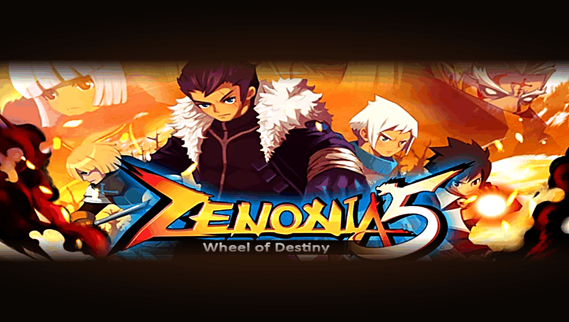

<h1 align="center">
  <br>
  Zenonia 5: Wheel of Destiny · PS Vita Port
</h1>

<p align="center">
  <a href="#-status--playability">Status & Playability</a> •
  <a href="#setup-instructions-for-players">How to install</a> •
  <a href="#controls">Controls</a> •
  <a href="#known-issues">Known Issues</a> •
  <a href="#build-instructions-for-developers">How to compile</a> •
  <a href="#credits--acknowledgments">Credits</a>
</p>

An unofficial, native **iOS-to-PS Vita wrapper port** of *Zenonia 5: Wheel of Destiny* (originally developed by **Gamevil**). There is no ELF of the game here: this port ships its own **Mach-O loader** that maps the official ARMv7 executable (`Zenonia5`, armv7 slice of the 1.1.3 IPA) into PS Vita RAM and replaces the Apple frameworks it uses (Foundation, UIKit, CoreGraphics/CoreText, AudioToolbox, AVFoundation, OpenAL, SystemConfiguration, StoreKit) with native implementations on top of **vitaGL**, **FreeType**, **libvorbis** and the Vita system libraries. The game's online server no longer exists, so the login it needs is answered by a small **server emulator** built into the loader.

---

## 🎮 Status & Playability

**Status: PLAYABLE (beta) (v0.1)**

On physical PlayStation Vita hardware the game boots, reaches the title screen and the main menu without online popups, and is playable in-game.

- [x] **Mach-O loader**: maps the image `0x4000–0x24C000` at `0x98004000` (`MACHO_SLIDE`), applies 33,785 rebase words, resolves 2,889 import slots (46 left as logging stubs), registers the game's 116 Objective-C classes and runs its 217 static initializers. *Verified on console.*
- [x] **Graphics**: cocos2d-x (GLES1) on vitaGL. The game is told it runs on an iPhone 5 (`UIScreenMode` 640×1136, landscape views 568×320), so it uses its 16:9 layout, scaled to the full 960×544 screen. *Verified on console.*
- [x] **Text & Fonts**: CoreText/CoreGraphics/FontLabel text is rendered with FreeType from one bundled `font.ttf`: NanumGothic (Latin + Korean) merged with the accented Latin glyphs of DejaVu Sans (`tools/merge_latin_font.py`), so Spanish text shows á é í ó ú ñ. *Verified on console.*
- [x] **Online**: Gamevil Live and the in-app purchase notice are disabled (Objective-C method overrides, port of the iPhone tweak in `tools/iphone/z5nolive.m`); the login to the game server is answered locally with a default player ID (`jugador01`). *Verified on console.*
- [x] **Touch & Controls**: front touch screen plus physical buttons mapped to the on-screen joystick, attack and skills through `controls.txt`. *Verified on console.*
- [x] **Audio**: music (`AVAudioPlayer`) and sound effects (OpenAL/CocosDenshion) play through `sceAudioOut` from `.ogg` files converted from the IPA. *Verified on console.*
- [x] **Saves**: progress is written to `ux0:data/zenonia5ios/Documents/zndata.dat`.
- [x] **Hidden touch HUD**: the on-screen joystick, attack and skill buttons are hidden (still active to touch); **L + R** shows or hides them.
- [ ] **Performance**: CPU at 444 MHz. The game caps itself at 30 FPS; menus run at 27–30 FPS, busy fights drop to about 21–24 FPS, and going from the title to the menu still takes several seconds (see Known Issues).

---

## Disclaimer

**Zenonia** is a registered trademark of **Gamevil Inc. (Com2uS Holdings)**. The work presented in this repository is unofficial and is not produced, endorsed, or sanctioned by Gamevil or any affiliated entities.

This software does NOT contain original game code, binaries, copyrighted graphics, or game assets. The authors do not promote or condone piracy in any way. To play, you must provide your own legally obtained, **decrypted** copy of the iOS `.ipa`.

---

## Setup Instructions (For Players)

1. **CFW & Plugins**: PS Vita on Custom Firmware (**Enso 3.60 / 3.65** recommended) with **kubridge** in `ur0:tai/config.txt`:
   ```ini
   *KERNEL
   ur0:tai/kubridge.skprx
   ```
2. **Shader Compiler**: `libshacccg.suprx` must be in `ur0:data/` (extract it with **ShaRKBR33D**).
3. **Game Files**: a decrypted *Zenonia 5* **1.1.3** IPA (`cryptid 0`). On a PC with Python 3 (+ `capstone`) and `ffmpeg`, clone this repo, extract `Payload/Zenonia5.app/` and run:
   ```bash
   tools/stage_data.sh path/to/Zenonia5.app
   ```
   It builds `ux0_data/zenonia5ios/`: the app bundle, `rebase.bin` / `binds.bin` and the music converted to `.ogg`.
   (`rebase.bin` and `binds.bin` are also attached to the release.)
4. **Copy to the Vita** (`ux0:data/zenonia5ios/`), plus `extras/controls.txt`:
   ```
   ux0:data/zenonia5ios/
     game_app/      the app bundle (executable + data, sound/*.ogg)
     rebase.bin     relocation table for the 1.1.3 executable
     binds.bin      import slots resolved by the loader
     controls.txt   button -> touch mapping (editable over FTP)
     Documents/     created automatically — your save (zndata.dat)
     logs/          created automatically — zenonia5ios_NNN.log, one per run
   ```
5. **Install VPK**: install `zenonia5ios.vpk` with VitaShell.

---

## Controls

| Input | Action | Status |
| :---: | :--- | :---: |
| **Touch screen** | Game touch controls | ✅ Working |
| **Left stick / D-Pad** | Move (drags the on-screen joystick) | ✅ Working |
| **Cross (✕)** | Attack | ✅ Working |
| **Square / Triangle / Circle / R** | Skills | ✅ Working |
| **Start** | Pause | ✅ Working |
| **Select / L** | Skip (red button, top right) | ✅ Working |
| **L + R** | Show / hide the touch joystick, attack and skill buttons | 🧪 New |

> [!TIP]
> Every button is just a touch on a screen point, defined in `ux0:data/zenonia5ios/controls.txt` (568×320 coordinates, up to 10 buttons plus `STICK x y radius`). Edit it over FTP; no rebuild needed. Holding **Select + Start** for 2 s rotates the image (saved in `rotation.txt`).

---

## Known Issues

- **Title → menu is slow**: each login re-reads and rewrites the save, which takes about 1.7 s per step on the Vita's CPU, plus texture decoding of large UI sheets. v0.1 removes a fixed 1 s wait per connection, but the transition is still several seconds.
- **Frame drops in busy fights**: about 21–24 FPS against the game's 30 FPS cap; GPU time is small (≈2 ms), most of the frame is game code. Profiling is pending.
- **Online features disabled**: Gamevil Live, PvP, rankings, mail, gacha and the shop talk to an emulated server; anything beyond the login gets an empty answer and may show empty lists.
- **No in-app purchases**: the store is disabled on purpose.
- **Crash dumps** are written by the system to `ux0:data/` (not to the game folder).

---

## Build Instructions (For Developers)

### Prerequisites

- [VitaSDK](https://vitasdk.org/) (`$VITASDK`) with `kubridge`, FreeType, libvorbis/libogg, libpng and zlib.
- CMake 3.14+, Python 3 with `capstone` and `fontTools` (for the tools), `ffmpeg` (music conversion).
- A decrypted 1.1.3 IPA, extracted locally (never committed; `game_app` is a symlink to the `.app`).

### Compilation Commands

```bash
git clone https://github.com/MetalSyntax/Zenonia5-psvita-port.git
cd Zenonia5-psvita-port
tools/stage_data.sh game_app
cmake -S . -B build
cmake --build build
```

### Deploy & Debug

```bash
python3 -I tools/deploy_data.py          # sync ux0_data/zenonia5ios/ to the Vita over FTP (VitaShell, port 1337)
python3 -I tools/deploy_data.py --logs   # fetch logs/zenonia5ios_NNN.log and .psp2dmp crash dumps
```

A crash at `PC = X` maps to `X - 0x98000000` in the armv7 slice (`lipo -thin armv7`, `otool -tV`); `tools/annotate.py` helps read the disassembly. Architecture and progress notes: [`PORTING_PLAN.md`](PORTING_PLAN.md) and [`port_progress.md`](port_progress.md).

---

## Credits & Acknowledgments

- **Zenonia 5: Wheel of Destiny** is intellectual property of **Gamevil Inc.**, built on cocos2d-x.
- **vitaGL** graphics library by [Rinnegatamante](https://github.com/Rinnegatamante/vitaGL).
- **kubridge** plugin by [Bythos](https://github.com/bythos14/kubridge).
- **FreeType**, **libvorbis**, **NanumGothic** (SIL OFL) and **DejaVu Sans** (Bitstream Vera license) fonts.
- The Mach-O loader and runtime are shared with [Ferrari-GT-Evolution-vita](https://github.com/MetalSyntax/Ferrari-GT-Evolution-vita) and [Feanor-iOS-vita](https://github.com/MetalSyntax/Feanor-iOS-vita); sibling ports: [Zenonia 4](https://github.com/MetalSyntax/Zenonia4-psvita-port), [Zenonia 3](https://github.com/MetalSyntax/zenonia3-psvita-port), [Zenonia 2](https://github.com/MetalSyntax/Zenonia2-psvita-port).
- Special thanks to the PS Vita homebrew and porting community.
